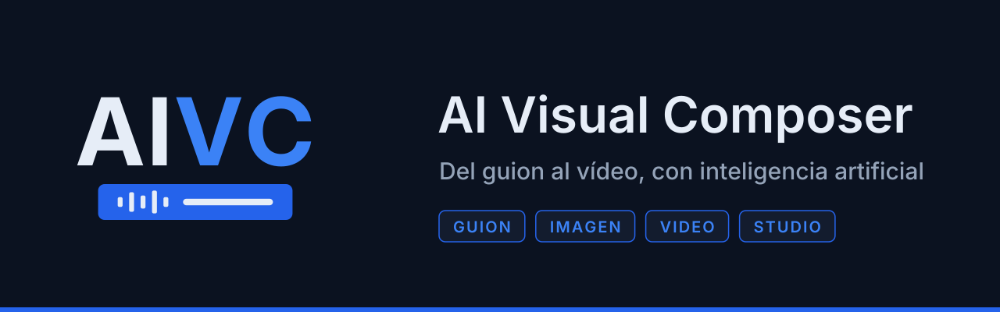
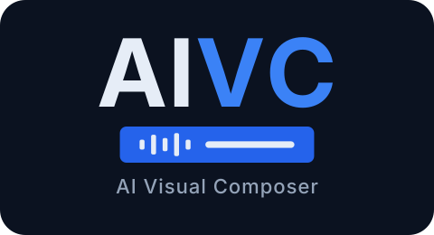
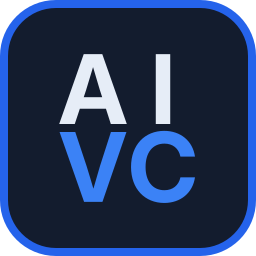

<p align="center"></p>

<p align="center">
  
  
  
  
  <a href="https://github.com/juangalisteo/ai-visual-composer/actions/workflows/tests.yml"></a>
</p>

<p align="center">
  <b>Sistema de producción audiovisual asistido por inteligencia artificial, con arquitectura guiada por datos (código/configuración).</b>
</p>

---

## Índice

- [Qué hace](#qué-hace)
- [Formatos](#formatos)
- [Requisitos e instalación](#requisitos-e-instalación)
- [Uso](#uso)
- [Más documentación](#más-documentación)
- [Estructura del proyecto](#estructura-del-proyecto)
- [Tecnologías](#tecnologías)
- [Diseño](#diseño)
- [Próximamente](#próximamente)
- [Uso responsable](#uso-responsable)
- [Autor](#autor)
- [Licencia](#licencia)

---

## Qué hace

A partir de un guion, un tema o una descripción visual, AI Visual Composer genera voz, subtítulos, imágenes o clips de vídeo y compone el vídeo final; también termina material propio ya grabado.

| Componente | Qué hace |
|---|---|
| **GUION** | Parte de un texto completo escrito por el usuario y lo convierte en un proyecto de Imagen o de Video. |
| **IMAGEN** | A partir de un tema o una idea, escribe el guion con IA y genera el vídeo con imágenes generadas. |
| **VIDEO** | Igual que IMAGEN, pero convierte cada imagen en un clip (imagen a vídeo) antes de componer el vídeo final. |
| **DISEÑO** | Dentro de GUION, genera una sola imagen o un solo clip a partir de una descripción visual directa, sin voz ni subtítulos. |
| **STUDIO** | Termina material propio ya grabado (vídeo, audio o SRT): transcribe, pinta subtítulos, cambia el audio, añade intro/outro, monta varios vídeos o exporta un SRT. |

## Formatos

Dos formatos de salida: **vertical 9:16** (Reels, TikTok, YouTube Shorts) y **horizontal 16:9** (YouTube). Detalle completo en [ARCHITECTURE.md §4](docs/ARCHITECTURE.md#4-formatos).

## Requisitos e instalación

Windows 10 u 11, Python 3.13 y FFmpeg; además, según la ruta que uses, Ollama, ComfyUI (Flux y Wan), Piper y Whisper en local. Guía completa, paso a paso: **[INSTALL.md](docs/INSTALL.md)**.

## Uso

Con el entorno instalado, se arranca con:

```bat
python main.py
```

Qué pregunta cada menú, qué archivo va en cada carpeta de `input/` y dónde sale el resultado: **[START.md](docs/START.md)**.

## Más documentación

- **[ARCHITECTURE.md](docs/ARCHITECTURE.md)** — cómo está construido por dentro.
- **[SUBTITLES.md](docs/SUBTITLES.md)** — familias y perfiles de subtítulos.
- **[VOICEOVER.md](docs/VOICEOVER.md)** — voces, ritmo y duración del guion generado.
- **[ROADMAP.md](docs/ROADMAP.md)** — estado actual y próximas etapas.

## Estructura del proyecto

```
AI_VISUAL_COMPOSER
├── app/              Código de la aplicación: menús, coordinadores, builders y servicios
├── assets/           Fuentes Anton y Oswald; la música y los overlays los pone cada persona
├── certification/    Comprobaciones de certificación real de imagen y vídeo
├── config/           Formatos, perfiles operacionales y de subtítulos, workflows de ComfyUI
├── data/             Intenciones y lecturas narrativas (YAML); hoy solo las usan los tests
├── docs/             Toda la documentación del proyecto
├── input/            Guion, tema y material de STUDIO que aporta el usuario
├── prompts/          Textos de los prompts de guion, storyboard, imagen y vídeo
├── tests/            Pruebas automáticas (pytest)
├── tools/            Utilidades de desarrollo
├── main.py           Punto de arranque del programa
└── requirements.txt  Dependencias de Python
```

Las reglas para los agentes de IA que colaboran en el desarrollo están en [AGENTS.md](AGENTS.md).

## Tecnologías

| | |
|---|---|
| **Python** | Lenguaje de la aplicación |
| **FFmpeg / FFprobe** | Procesado, inspección y composición final de audio y vídeo |
| **Ollama** | Modelo de lenguaje local: guion, storyboard y dirección cinematográfica |
| **ComfyUI** (Flux + Wan) | Generación de imágenes y de clips imagen a vídeo (I2V) |
| **Piper** | Síntesis de voz local |
| **OpenAI Whisper** | Transcripción y ajuste temporal de subtítulos |

## Diseño

Fondo azul noche y un solo color de acento, el azul.

| Color | Código | Uso |
|---|---|---|
|  Fondo | `#0B1220` | Fondo del banner y del logo |
|  Tarjetas | `#131C2E` | Recuadros e icono |
|  Texto | `#E6EDF7` | Letras «AI» y textos |
|  Secundario | `#94A3B8` | Textos de apoyo |
|  Acento | `#3B82F6` | Letras «VC» |
|  Insignias | `#2563EB` | Insignias y barra de subtítulo |

<p align="center">
  
  &nbsp;&nbsp;&nbsp;
  
</p>

- **Logo** ([docs/aivc-logo.svg](docs/aivc-logo.svg)): las letras «AIVC» con el nombre «AI Visual Composer» debajo.
- **Icono** ([docs/aivc-icon.svg](docs/aivc-icon.svg)): «AI» sobre «VC» en un recuadro, para tamaños pequeños.

Letras del logo: Inter (Rasmus Andersson), licencia SIL OFL.

## Próximamente

Herramientas de calidad, flujo de trabajo en GitHub, mejoras en la generación con IA, un traductor de guiones y, más adelante, clonación de voz. Detalle y orden completo en **[ROADMAP.md](docs/ROADMAP.md)**.

## Uso responsable

El contenido que produce AI Visual Composer está generado con inteligencia artificial: revísalo antes de publicarlo. Cuando llegue la clonación de voz, solo se admitirán voces propias o de alguien que haya dado su permiso.

## Autor

**Juan Bautista Galisteo Marqués** — autor y responsable del proyecto ([@juangalisteo](https://github.com/juangalisteo)).

## Licencia

Distribuido bajo la **Licencia Pública General de GNU v3.0** (GPL-3.0 o posterior). Consulta el archivo [LICENSE](LICENSE).

Puedes usar, estudiar, compartir y modificar AI Visual Composer. Si repartes una versión modificada,
también debe publicarse con licencia GPL y con su código fuente.

Copyright © 2026 Juan Bautista Galisteo Marqués.
Las versiones v1.2 y v2.0.0 se publicaron con licencia MIT.
